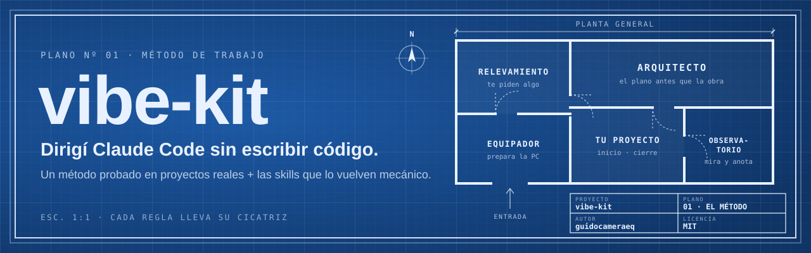
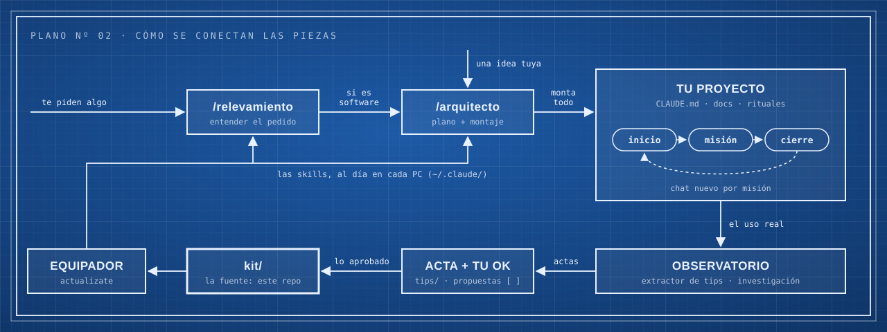

<p align="center">
  
</p>

<p align="center">
  <a href="docs/CHANGELOG.md"></a>
  <a href="https://github.com/guidocameraeq/vibe-kit/commits/main"></a>
  <a href="LICENSE"></a>
  
  
</p>

<p align="center">
  <b>Un método para dirigir Claude Code sin saber programar</b>, y las skills que lo vuelven mecánico.<br>
  Probado en proyectos reales: cada regla lleva escrito dónde dolió.
</p>

<p align="center">
  <a href="#cómo-funciona">Cómo funciona</a> ·
  <a href="#las-piezas">Las piezas</a> ·
  <a href="#un-día-de-trabajo">Un día de trabajo</a> ·
  <a href="#instalar">Instalar</a> ·
  <a href="GUIA-DE-USO.md">Guía de uso</a> ·
  <a href="docs/TODO.md">Hoja de ruta</a>
</p>

---

> [!NOTE]
> **Repo personal y en evolución.** Es el taller de Guido: lo usa todos los días y lo cambia cuando la
> evidencia lo pide. Es público para que cualquiera lo mire o lo copie, pero **no es un producto ni
> tiene soporte**. Algunas cosas son propias de su trabajo (sus carpetas, su método de relevamiento).

## El problema

Dirigir Claude Code sin escribir código funciona… hasta que se rompe, y siempre por los mismos lados:
chats eternos que se compactan y se olvidan, el "estado actual" escrito en seis lugares que se
contradicen, la misma corrección explicada diez veces, proyectos que arrancan sin plano.

**vibe-kit parte de una idea: el contexto vive en archivos, no en la conversación.** El chat se
descarta; lo que importa queda escrito y cualquier chat nuevo lo retoma. Sobre eso, un puñado de
skills que hacen el trabajo ordenado sin que tengas que acordarte.

## Cómo funciona

<p align="center">
  
</p>

1. **Antes de construir, un plano.** Si el pedido viene de otra persona, `/relevamiento` lo entiende
   primero; si es una idea tuya, vas directo a `/arquitecto`, que te entrevista y monta el proyecto.
2. **Cada proyecto trabaja igual**: un chat por misión, que arranca con `inicio` y termina con
   `cierre`. El chat se tira; el proyecto recuerda.
3. **El sistema aprende del uso real.** El observatorio mira los chats y los tips, deja actas con
   propuestas, y lo que aprobás entra al kit. El Equipador lo lleva a cada PC.

## Las piezas

Cada pieza es una *skill*: instrucciones que Claude Code carga cuando las llamás.

| | Pieza | Qué hace |
|---|---|---|
| 📐 | **`/arquitecto`** | Piensa antes de hacer. Proyecto nuevo → entrevista, plano y montaje completo. Feature grande sobre algo que ya anda → explora el código y escribe qué cambia y qué no. ¿No sabés cómo pedir algo? → te arma el pedido |
| 📋 | **`/relevamiento`** | Cuando te piden algo en el laburo: ordena la charla en 4 documentos con un PDF por etapa, y decide con evidencia si hace falta software (construir es solo una de seis salidas) |
| 🧰 | **`/arquitecto-skills`** · el Equipador | Prepara la PC: instala las skills de un menú curado, las actualiza y se actualiza a sí mismo (`actualizate`) |
| 🔁 | **`inicio` / `cierre`** | Los rituales de cada chat: arrancar sabiendo dónde quedaste, cerrar con todo guardado, commiteado y listo para tirar el chat |
| 🗂️ | **`/docs-fyd`** | La documentación técnica de auditoría de un repo, sacada del código; lo que el código no sabe, te lo pregunta con opciones |
| 🔭 | **El observatorio** | Mira y anota, no toca: extrae tips de videos e investiga los chats reales para proponer mejoras ([más](observatorio/)) |

## Un día de trabajo

```text
vos      /arquitecto quiero una app para controlar los remitos del depósito
claude   (te entrevista de a una pregunta, te muestra el plano, y con tu OK monta el proyecto)

         ── al otro día, chat nuevo en la carpeta del proyecto ──

vos      inicio
claude   Estado: plano listo, nada construido · Próximo: la carga de remitos · Bloqueos: ninguno
vos      dale, arrancá con la carga de remitos
claude   (trabaja, prueba, te muestra la evidencia)
vos      cierre
claude   (deja los docs al día, commitea y sube) Chat listo para descartar.
```

Las recetas para cada situación ("me pidieron algo", "quiero una feature grande", "estoy en una PC
nueva"…) están en la **[guía de uso](GUIA-DE-USO.md)**.

## Instalar

Hace falta: [Claude Code](https://claude.com/claude-code) funcionando y git.

1. Clonar este repo.
2. Abrir Claude Code en `kit/` y pegar el prompt de [`kit/INSTALAR.md`](kit/INSTALAR.md). Copia las
   skills a `~/.claude/`, pregunta dónde viven tus proyectos y verifica todo.
3. Al final ofrece equipar la máquina con el menú curado de skills.

¿Ya lo tenés? Decile **`actualizate`** al Equipador y baja lo último.

> [!IMPORTANT]
> **La regla de la casa:** este repo es la fuente; `~/.claude/` es una copia. Los cambios se hacen en
> `kit/` y se sincronizan; nunca se edita `~/.claude/` directo.

## Principios

- **El contexto vive en archivos.** Un chat por misión; el que retoma lee, no recuerda.
- **Cada regla lleva su cicatriz.** Nada entra sin la evidencia de dónde dolió.
- **Lo mecánico frena; la prosa no.** Lo que se sigue rompiendo escrito en prosa se vuelve script, hook
  o campo obligatorio.
- **Evidencia o "no verificado".** Nunca "listo" a secas.
- **Vos decidís.** Las herramientas proponen con opciones y una recomendación; nada se aplica sin tu OK.

## En qué anda

- 🧭 **Hoja de ruta y pendientes:** [`docs/TODO.md`](docs/TODO.md) — ahora: diseñar el pack para que
  otra persona lo pueda usar.
- 📜 **Qué cambió y cuándo:** [`docs/CHANGELOG.md`](docs/CHANGELOG.md) · **por qué es como es:**
  [`docs/DECISIONS.md`](docs/DECISIONS.md) · **para qué existe:** [`docs/MISION-Y-VISION.md`](docs/MISION-Y-VISION.md)

<details>
<summary><b>Qué hay en cada carpeta</b></summary>

| Carpeta / archivo | Qué es |
|---|---|
| [`GUIA-DE-USO.md`](GUIA-DE-USO.md) | Recetas por situación y frases para decirle a Claude. **Empezá por acá** |
| [`PLAYBOOK-MAESTRO.md`](PLAYBOOK-MAESTRO.md) | El método completo: documentación y sistema de trabajo, con su porqué |
| [`kit/`](kit/) | **La fuente** de lo instalable: las skills, el agente red-team y el instalador |
| [`manuales/`](manuales/) | El detalle a fondo de cada pieza |
| [`observatorio/`](observatorio/) | El Extractor de tips y la investigación de chats |
| [`tips/`](tips/) | Las actas del observatorio, con propuestas para aprobar |
| [`docs/`](docs/) | Pendientes, historia, decisiones, descartes y planos ([índice](docs/README.md)) |
| [`assets/`](assets/) | El banner y los diagramas |
| [`legacy/`](legacy/) | Lo superado, archivado con su lápida (no se borra) |
| `CLAUDE.md` · `.claude/` | Las reglas para Claude en este repo y sus rituales |

</details>

## Licencia

[MIT](LICENSE), salvo `docs/consulta/referencia-prompts-fyd.md`, que reproduce texto de FyD Sistemas y
no está cubierto ([`NOTICE`](NOTICE)).
